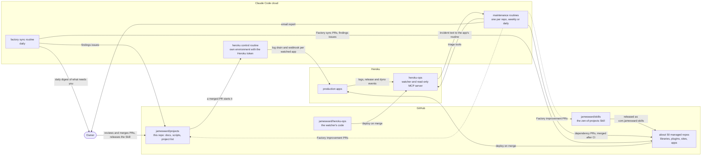
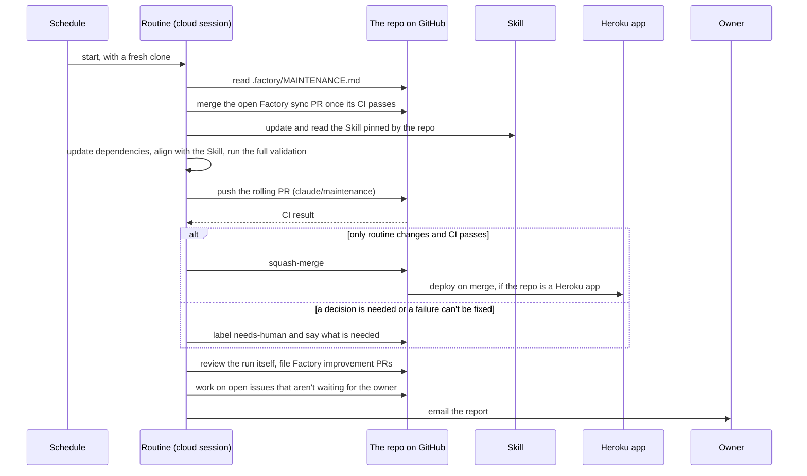
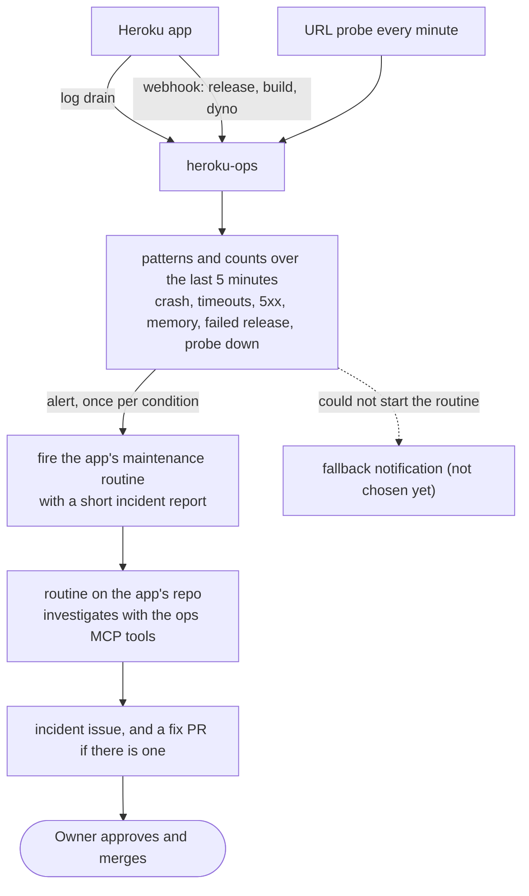
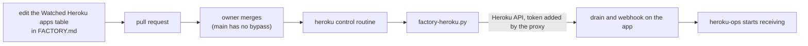

# The factory

James Ward maintains about fifty projects: libraries, build plugins, websites, code samples and a few production services. The factory keeps them current and consistent with very little human time. Scheduled [Claude Code routines](https://code.claude.com/docs/en/routines) update each project's dependencies, run its tests, merge what is safe and ask for a human only when a decision is needed. A small service watches the production apps and starts the right routine when something breaks.

This repo is the factory's control room: the setup instructions, the project list and schedules, and the scripts that keep everything in line. This README is the map. The other docs go deeper:

| Read | For |
|---|---|
| [DESIGN.md](DESIGN.md) | why it is built this way: the principles every change has to fit |
| [FACTORY.md](FACTORY.md) | how to set it up and run it, the project list, schedules and production identifiers |
| [TODO.md](TODO.md) | what is not done yet, and the open questions |
| [AGENTS.md](AGENTS.md) | rules for agents (and people) editing this repo |
| the [zen-of-projects Skill](https://github.com/jamesward/skills) | how every project is maintained, and the maintenance routine itself |

## The big picture

Dashed arrows are proposals that a human reviews. The arrow from heroku-ops to the routines is built but not switched on yet (see [what is live](#what-is-live-and-what-is-planned)).

## The parts

**Managed repos.** Every project lives in its own repo and has a `.factory/MAINTENANCE.md` file: a short, identical bootstrap that tells the routine to read the Skill and follow it. The project's own `AGENTS.md` records what is special about it (its test command, its Java version, why a dependency is pinned). [FACTORY.md](FACTORY.md) lists every repo, its schedule and its routine.

**The Skill ([jamesward/skills](https://github.com/jamesward/skills)).** `zen-of-projects` holds the conventions for every project and the maintenance routine's steps. It is published as `com.jamesward:skills` and each project pins a version, so a change to the Skill reaches the routines only after a release. Changing the Skill changes every project at once, which is why it is released by hand.

**Maintenance routines.** A routine is a saved Claude Code session that runs on a schedule in a cloud environment with Java 25 (`JDK25`). There is one per repo, named `<repo> maintenance`. Each run follows the Skill: update the dependencies to their latest releases, align the project with the conventions, run the full validation, push a rolling pull request, wait for CI, and merge it when it holds only routine changes. Anything else gets the `needs-human` label and waits.

**Factory sync.** A daily routine runs [`factory-sync.py`](factory-sync.py). It keeps the factory-owned files in every repo equal to the factory's version (the bootstrap, the build launcher, the MCP server settings) through `Factory sync:` pull requests that each repo's next maintenance run merges. It also files issues for things that are wrong in the factory itself (repo settings that drifted, sync PRs that were never merged) and ends with a digest of everything waiting for the owner (on Mondays with the last week's numbers). It also files an issue when a repo's default branch has failing CI.

**Control plane.** The `heroku control` routine runs in a cloud environment of its own, because it is the one place that holds a Heroku token. When a pull request to this repo is merged, it runs [`factory-heroku.py`](factory-heroku.py), which gives each app in the "Watched Heroku apps" table of FACTORY.md a log drain and a webhook that point at heroku-ops. The token is stored as a network secret, so the session can use it without ever reading it. `main` in this repo accepts changes only through pull requests, with no bypass, because anything that can change this repo can change what runs with that token.

**Production apps and heroku-ops.** The production apps are ordinary Heroku apps. [heroku-ops](https://github.com/jamesward/heroku-ops) is a small Scala service that receives their logs and events and decides from patterns and counts (a crash, repeated timeouts, memory over quota, failed probes) whether something is wrong. Detection is heuristics, not AI. It holds no GitHub or Heroku-write credentials. It also serves a read-only [MCP](https://modelcontextprotocol.io) endpoint with triage tools (which apps are degraded, the log lines behind an alert, per-minute counts, recent releases, a live probe) for routines and for the owner.

**Scripts in this repo.** They are run by hand or by a routine, and each says how to use it in its docstring.

| Script | Does |
|---|---|
| [`factory-routines-sync.py`](factory-routines-sync.py) | creates and updates the routines to match the schedule tables |
| [`factory-sync.py`](factory-sync.py) | syncs factory-owned files into every repo, files findings issues, prints the digest |
| [`factory-github-settings.py`](factory-github-settings.py) | checks and fixes repo settings (watch, wiki, branch cleanup, Dependabot alerts) |
| [`factory-heroku.py`](factory-heroku.py) | registers the drains and webhooks for the watched apps |
| [`factory-transcript.py`](factory-transcript.py) | lists a routine's runs and prints a run's transcript |
| [`factory-land.sh`](factory-land.sh) | lands a change on `main` through a pull request |
| [`factory-repo-check.sh`](factory-repo-check.sh) | what a new repo needs before it can join |
| [`jdk25-setup.sh`](jdk25-setup.sh) | the setup script of the `JDK25` cloud environment |

## How it flows

### A maintenance run

### The factory improves itself

Every run ends with a review of the run itself: tool friction, instructions that were missing or wrong, anything the agent had to guess. Each finding goes where it fixes the most: the project's `AGENTS.md` if it concerns only that project, the Skill if it applies to every project, this repo if it concerns setup or scripts. The last two become `Factory improvement:` pull requests that routines never merge. The owner reviews them, merges them and releases the Skill, and the next round of runs picks the change up. The daily factory sync adds its own checks and opens a `needs-human` issue for each finding, closing it when the problem goes away.

### Watching production

The incident report is built from a fixed set of fields, truncated and quoted, because production logs contain text anyone can influence. It says what happened and never what to do. A fix is always a pull request. Nothing in the factory resizes a dyno, changes a plan or adds an add-on on its own: it works inside the limits recorded for each app, and a bigger dyno is only ever an option offered to the owner.

### Registering a watched app

## Who holds which credential

| Part | Holds | Why this much |
|---|---|---|
| maintenance routines | the owner's GitHub identity through the Claude GitHub App; the heroku-ops MCP token as a network secret | they open PRs and merge routine ones; the MCP server is read-only |
| `heroku control` routine | a Heroku token, as a network secret on an environment nothing else uses | it registers drains and webhooks; it runs only on merged PRs, a schedule or the owner's request, and reads only content the owner approved |
| heroku-ops | the secret its per-app tokens derive from, and one API token per routine it may start | it needs no GitHub or Heroku write access, so it has none |
| the owner | everything | merges anything beyond routine work |

The reasoning behind this table is in [DESIGN.md](DESIGN.md) (principles 10, 12 and 14).

## What is live, and what is planned

Live:
- maintenance routines for every managed repo, the daily factory sync with its findings issues and digest
- the `heroku control` routine, with `main` protected
- heroku-ops deployed, receiving logs and webhooks from its first watched app (`json-paste`), in observe-only mode: an alert is logged, and no routine is started yet
- the read-only MCP server (bearer token; the connector check in claude.ai is being tuned)

Planned (details in [TODO.md](TODO.md)):
- the incident procedure in the Skill, then firing the routines
- a fallback notification channel for incidents that can't reach a routine
- the rest of the production apps, an inventory of their dynos and add-ons in FACTORY.md, a dashboard through MCP Apps
- letting low-risk production fixes merge without waiting for the owner

## Common tasks

- **Add a repo to the factory:** [FACTORY.md](FACTORY.md), "Per-repo checklist", then a row in a schedule table and `./factory-routines-sync.py --apply`.
- **Watch a Heroku app:** add it to the "Watched Heroku apps" table in FACTORY.md and merge the pull request.
- **See what a routine did:** `./factory-transcript.py <owner/repo> --last`. A green run status only means the session ended cleanly; read the transcript.
- **See what needs you:** the daily email, or `./factory-sync.py --digest`.
- **Change this repo:** `./factory-land.sh "message" path...`, which opens and merges a pull request. Read [AGENTS.md](AGENTS.md) first.
